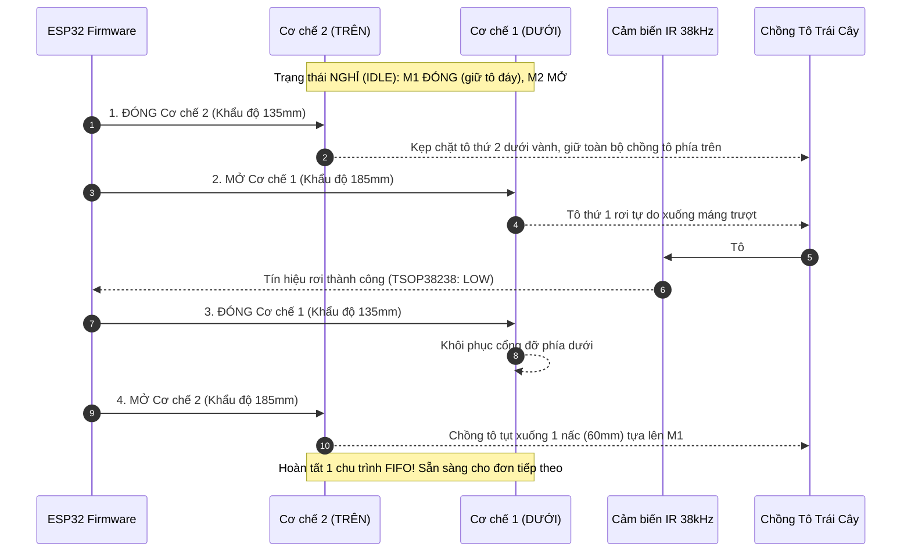

# Báo Cáo Kỹ Thuật: Cơ Chế Màn Chập Iris 2 Tầng & Mô Hình 3D FreeCAD Máy Bán Trái Cây FreshVend

## 1. Tổng Quan Cập Nhật `report.docx`

File [report.docx](file:///f:/project/repo-github/pcb/pcb/report.docx) (bản gốc đã sao lưu tại [report_original_backup.docx](file:///f:/project/repo-github/pcb/pcb/report_original_backup.docx)) đã được chỉnh sửa đồng bộ với tiến độ thiết kế phần cứng và mạch điều khiển:

1. **Cơ chế nhả tô (Mục 3.1 & 3.3)**: Thay thế hoàn toàn mô tả cơ chế trục xoắn (shaft-based/coil) cũ bằng **Cơ chế màn chập khẩu độ Iris 2 tầng (Dual-Tier Iris Aperture Escapement Mechanism)** điều khiển bằng động cơ Servo MG996R, đảm bảo xoay vòng sản phẩm chuẩn **FIFO (First-In, First-Out)**.
2. **Kích thước & Kết cấu máy (Mục 3.4)**: Bổ sung thông số kích thước khung máy **800 mm (Rộng) x 600 mm (Sâu) x 800 mm (Cao)** từ nhôm định hình 3030, chứa 2 cột tô độc lập, khay nhận và khoang điện.
3. **Chi tiết linh kiện & Ngăn xếp phần cứng (Mục 3.5.2)**:
   - **MCU**: ESP32 DevKit V1 38 chân (cắm header socket trên board điều khiển).
   - **Động cơ**: 4x Servo MG996R quay liên tục 360° (mỗi cột 2 con: Iris Trên và Iris Dưới).
   - **Nguồn điện**: Nguồn tổ ong công nghiệp 12V 40A (480W).
   - **Mạch nguồn hạ áp**: 
     - 2x Module Buck XL4015 (6.0V, >=5A mỗi nhánh) chuyên cấp nguồn cho Servo cột 1 & cột 2, kèm cầu chì tự phục hồi PTC (~2.5A) và tụ lọc dung lượng lớn 2200µF/25V chống sụt áp khi khởi động motor.
     - 1x Module Buck MP1584EN (5.0V, 3A) chuyên cấp cho logic ESP32 và cảm biến phát IR, cách ly hoàn toàn khỏi xung nhiễu của động cơ.
   - **Cảm biến quang học**: 2x Cổng quang hồng ngoại điều chế xung 38kHz (đầu thu TSOP38238/VS1838B trên board con `FV-IR-RX_RevA` đối diện LED phát 940nm TSAL6200 qua transistor S8050) phát hiện tô rơi chính xác, chống nhiễu ánh sáng ban ngày.
   - **PCB tùy chỉnh**: Mainboard `FV-CTRL_RevA` (2 lớp, 100x100mm, 100% THT) và mạch con `FV-IR-RX_RevA`.
4. **Phân chia gói công việc (Task Package 2)**: Cập nhật nhiệm vụ thiết kế 3D CAD trên FreeCAD, gia công in 3D cơ chế Iris, hiệu chuẩn servo và lập trình firmware ESP32 điều khiển chu trình FIFO.

---

## 2. Nguyên Lý Cơ Chế Màn Chập Iris 2 Tầng (FIFO Escapement)

Mỗi cột chứa một chồng tô nhựa đựng trái cây (đường kính miệng $170\text{ mm}$, chiều cao $60\text{ mm}$, dung tích $850\text{ ml}$). Dọc theo cột bố trí 2 cụm cơ cấu Iris:
- **Cơ chế 1 (TẦNG DƯỚI - Lower Iris)**: Đặt tại cao độ $Z = 200\text{ mm}$ (ngay trên máng trượt).
- **Cơ chế 2 (TẦNG TRÊN - Upper Iris)**: Đặt tại cao độ $Z = 260\text{ mm}$ (cách tầng dưới đúng bằng chiều cao 1 chiếc tô: $60\text{ mm}$).

### Ưu điểm vượt trội so với lò xo xoắn truyền thống:
- Tô nhựa mỏng đường kính lớn ($170\text{ mm}$) có vành mềm rất dễ bị kẹt, móp méo nếu bị lò xo xoắn ép một bên.
- Cơ chế 6 cánh Iris tạo lực nâng **phân bố đều 360 độ** xung quanh mép vành tô, nhả rơi hoàn toàn theo phương thẳng đứng nhờ trọng lực, tuyệt đối không chèn ép dập nát trái cây bên trong.

---

## 3. Hệ Thống Tệp 3D CAD Đã Tạo Trong FreeCAD

| Tệp tin | Đường dẫn | Mô tả chi tiết |
|---|---|---|
| **FreeCAD Master Project** | [`cad/FreshVend_Machine_3D.FCStd`](file:///f:/project/repo-github/pcb/pcb/cad/FreshVend_Machine_3D.FCStd) | Mô hình 3D hoàn chỉnh gồm 71 đối tượng: khung 800x600x800mm, 2 cột tô, 4 cơ cấu Iris, servo MG996R, máng trượt, board `FV-CTRL_RevA`, nguồn 12V 40A. |
| **Mô hình xuất STEP** | [`cad/FreshVend_Machine_Assembly.step`](file:///f:/project/repo-github/pcb/pcb/cad/FreshVend_Machine_Assembly.step) | Định dạng trao đổi tiêu chuẩn công nghiệp STEP AP214 (hơn 22.800 thực thể). |
| **Macro mô phỏng chuyển động** | [`cad/simulate_dual_iris_dispense.FCMacro`](file:///f:/project/repo-github/pcb/pcb/cad/simulate_dual_iris_dispense.FCMacro) | Macro điều khiển chuyển động trực tiếp trong FreeCAD GUI kèm bảng điều khiển PySide tương tác. *(Đã tự động copy vào thư mục Macro của FreeCAD máy bạn)*. |
| **Script mở FreeCAD** | [`cad/launch_freecad_simulation.py`](file:///f:/project/repo-github/pcb/pcb/cad/launch_freecad_simulation.py) | Script khởi chạy nhanh FreeCAD kèm hướng dẫn mở mô phỏng. |
| **Tệp STL In 3D** | [`cad/stl/`](file:///f:/project/repo-github/pcb/pcb/cad/stl/) | Các chi tiết rời sẵn sàng cho máy in 3D FDM/SLA (Đế stator, vòng rotor, cánh kẹp, nắp chặn, gá servo, phễu nạp). |

---

## 4. Hướng Dẫn Xem Mô Hình & Chạy Chuyển Động Trên FreeCAD

1. Mở phần mềm **FreeCAD 1.1** trên máy của bạn (hoặc chạy lệnh: `python cad/launch_freecad_simulation.py`).
2. Mở tệp: `f:\project\repo-github\pcb\pcb\cad\FreshVend_Machine_3D.FCStd`.
3. Trên thanh Menu của FreeCAD, chọn: **Macro -> Macros...**
4. Chọn file **`simulate_dual_iris_dispense.FCMacro`** và nhấn nút **Execute**.
5. Bảng điều khiển chuyển động **FreshVend Dispensing Simulator** sẽ hiển thị:
   - Nhấn **CHẠY CHU TRÌNH ĐẦY ĐỦ (AUTO FIFO)** để xem toàn bộ quá trình: Cơ chế 2 đóng kẹp tô 2 $\rightarrow$ Cơ chế 1 mở nhả tô 1 $\rightarrow$ Tô rơi tự do kích hoạt cổng quang IR $\rightarrow$ Cơ chế 1 đóng lại $\rightarrow$ Cơ chế 2 mở nhả cả chồng tô tụt xuống $60\text{ mm}$ $\rightarrow$ Sẵn sàng cho lượt kế tiếp.
   - Hoặc nhấn các nút từng bước (1 đến 5) để quan sát chi tiết từng góc chuyển động.
